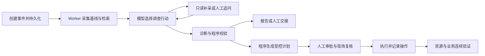

# K8s Incident Agent

面向 Kubernetes 应用的故障调查与受控恢复系统。围绕一个登记 Service 采集现场证据，由模型选择补采、追问或形成诊断；通过程序校验后生成修复计划，经人工审批执行，并重新验证资源与业务状态。

**项目状态：本轮开发与验收已由维护者于 2026-10-12 确认收尾。** 当前定位为部署在 ECS + kind 环境中的单人排障演示项目。包/API 版本仍为 `0.1.0`，阶段收尾不自动变更版本号。

## 核心能力

| 能力 | 实现 |
| --- | --- |
| 多轮调查 | 最多 5 轮决策、6 次模型调用；按缺失事实选择白名单只读工具，支持人工追问和同事件新轮次 |
| 证据与诊断 | 资源、事件、日志和登记业务检查；Runbook 检索；症状、根因假设、引用及未验证范围 |
| 可靠运行 | PostgreSQL 持久化任务、独立 worker、租约与 LangGraph 检查点；等待用户和审批时保存进度 |
| 受控修复 | 仅登记 Service selector 和 Deployment 指定容器 readiness HTTP path/port；程序生成参数，人工审批后执行 |
| 执行保护 | 绑定计划、证据与目标身份；执行前核对 UID、配置和版本；操作账本记录外部写入，结果不确定时先核对 |
| 恢复与复查 | 资源及登记业务连续观察、人工处理后的单次复查、稳定性观察与延时复查；保留历史 |
| 排障导出 | 调查摘要、最后一次模型输入输出、独立恢复计划/审批/执行/复查审计 |

技术栈：Python / FastAPI、LangGraph、PostgreSQL / pgvector、React / TypeScript、Docker Compose、Kubernetes。

## 工作流程



模型选择修复候选，程序从登记配置生成实际参数。引用、事实或权限不符合要求时拒绝继续；允许纠正的错误使用已有纠正机会，仍不合格时保守结束。部分纯诊断语义失败可生成程序证据报告，但不会因此获得写权限。

日志每次请求最近 1000 行、单份最多 256 KiB。保存原始采样；模型输入使用原生 JSON，并对可精确识别的重复探针访问日志保留次数、时间和行定位，异常日志保留原文。浏览器预览与完整正文按需读取分开。

调查保留调用次数限制和用量记账，不设置累计 Token、总时间或工具总次数额度。单次网络超时和恢复观察窗口独立保留。

## 运行

环境：Linux/ECS、Python 3.12、Docker Compose、kubectl、kind。以下命令在项目根目录执行；已有环境无需重建集群或覆盖 `.env`。

```bash
python3.12 -m venv .venv
source .venv/bin/activate
python -m pip install -e . pytest
```

首次从 `.env.example` 创建 `.env`，配置数据库、模型、Embedding 和 Kubernetes 访问。启用当前多轮后台工作流需要：

```dotenv
INCIDENT_AGENT_EXECUTION_MODE=queued
INCIDENT_AGENT_INVESTIGATION_ENABLED=true
```

示例文件保留兼容默认值，不能只复制后就假定多轮已开启。首次准备 Demo 与服务：

```bash
# 仅在集群不存在时创建
kind create cluster --name incident-agent
bash scripts/demo_v02.sh deploy
bash scripts/business_probe_up.sh
bash scripts/compose_up.sh
bash scripts/deploy_stage6b2b_backend.sh
```

演示目标为 `agent-demo/order-service`，登记配置见 [service profile](config/service-profiles/agent-demo.order-service.json)。业务检查器从集群内访问登记 Service，核对 HTTP 状态及响应内容。页面：`http://127.0.0.1:8080`；后端就绪检查：`http://127.0.0.1:8000/readyz`。

修改模型环境变量或后端逻辑后，等待活动任务结束，再运行 `bash scripts/deploy_stage6b2b_backend.sh` 更新 backend 与 worker。修改 Demo 才需要重新部署演示应用；前端变更单独构建。仅文档或本地导出脚本更新无需重启服务。

## 演示与验收

故障由操作者注入，权限与 Agent 分开。每次先 reset，再选择一个场景：

```bash
bash scripts/stage5_fault.sh reset
bash scripts/stage5_fault.sh selector_mismatch
# 其他场景：readiness_path_error、dependency_unavailable
```

在页面创建 `agent-demo/order-service` 事件，描述故障现象，不把脚本标签或正确答案写入事件。selector/readiness 配置漂移可提出审批计划；依赖故障提供证据和待验证判断，不自动扩缩容、重启依赖或放宽探针。

恢复窗口默认要求连续 3 次资源与登记业务采样通过。资源 ready、业务 passed 与工具执行成功分别记录；通过仅覆盖本次登记采样范围。selector 复查中的副本统计为空不表示失败，它直接核对批准 selector 和就绪端点。

```bash
# 在 ECS 虚拟环境中运行，使用真实隔离 PostgreSQL、受控模型/集群
bash scripts/accept_stage6bc2.sh
```

该脚本验证程序行为，不代表真实模型准确率；更早的恢复、并发和权限验收入口继续保留。阶段收尾依据维护者验收确认与分块记录，不发布未经测量的准确率、成本降幅或生产稳定性指标。

## 独立排障导出

```bash
python -m scripts.export_investigation_debug --incident-id YOUR_INCIDENT_ID --brief
python -m scripts.export_investigation_debug --incident-id YOUR_INCIDENT_ID --last-llm
python -m scripts.export_remediation_debug --incident-id YOUR_INCIDENT_ID
```

可加 `--run-id` 指定历史诊断轮次。调查文件保存到 `evals/results/investigation-debug/`；恢复文件保存到 `evals/results/remediation-debug/`，包括计划、审批、实际 patch、操作快照和已保存复查结果。导出只读取保存记录，不重新调用模型或操作集群，旧记录缺失内容不会补造。

## 使用边界

- 仅操作登记范围，不支持任意 Shell、URL、补丁或跨服务自主扫描。
- 依赖日志可以支持怀疑，但不能证明下游具体根因；Pod Ready 也不等于业务正常。
- 外部写结果不确定时先核对，不承诺跨 Kubernetes 与数据库的 exactly-once。
- 当前没有完整登录、审批角色授权或多租户隔离，适用于受控单人环境。
- 现场修复不会自动同步配置仓库；通过连续采样不代表所有副本、集群外入口或后续持续可用。

代码入口见 [代码阅读指南](docs/CODE_READING.md)；本轮交付范围见 [开发与验收记录](docs/K8s-Incident-Agent-开发与验收计划.md)。阶段文档保留历史细节，当前功能以本文和代码为准。
